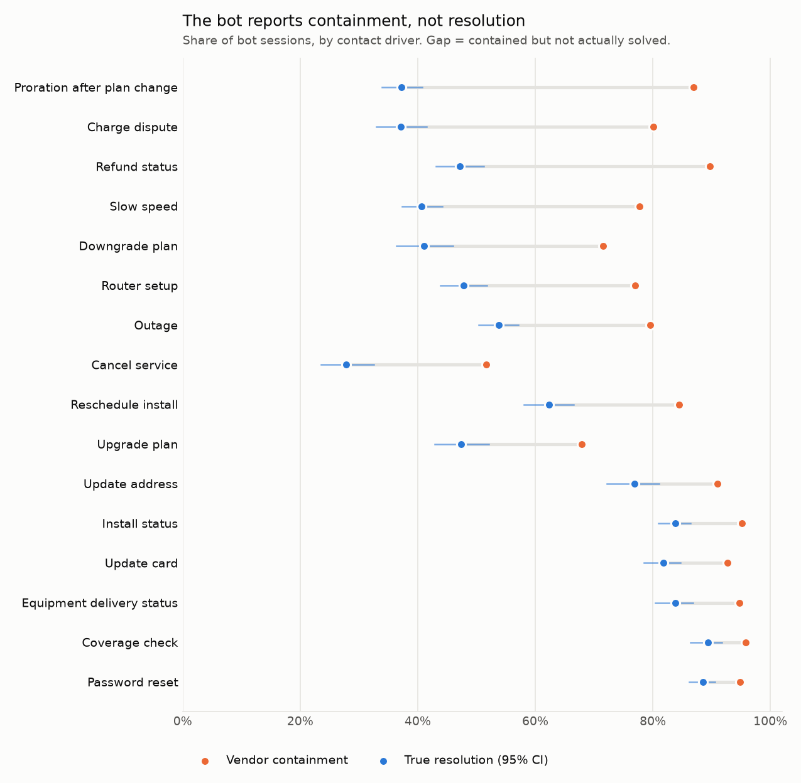
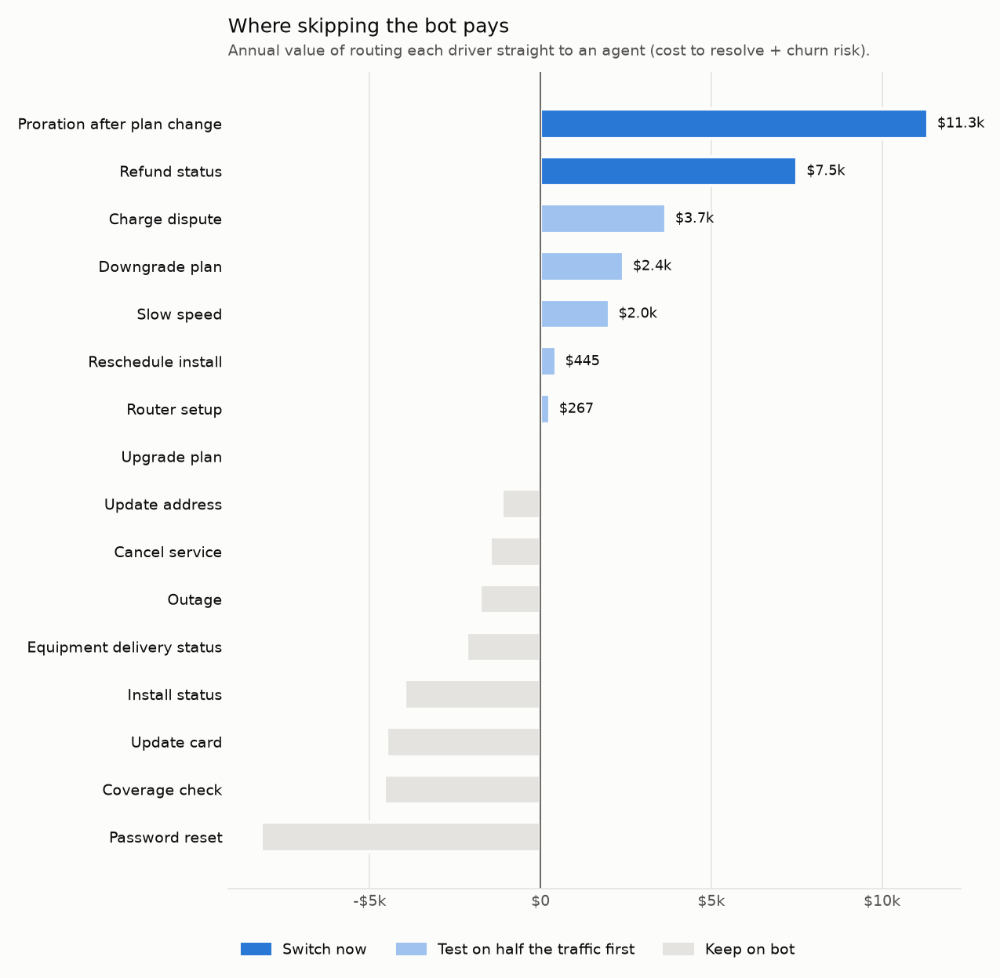

# Bot outcome audit

Generated 2026-10-18. Data: the fictional Northwind Connect operation simulated by [cx-journey-warehouse](https://github.com/qasimrazamalik-coder/cx-journey-warehouse), Jan to Jun 2025. All figures are reproducible with `python scripts/run_audit.py --bootstrap`.

## Answer

The bot vendor reports **85% containment**. Judged by what customers did next, the bot truly resolves **60%** of sessions (95% CI 59% to 61%). That is about **5,149 sessions a year** counted as success where the customer was not helped.

Falsely contained customers cancel more: within the same driver, 30-day churn is **+2.4 points** higher (95% CI +0.7 to +4.1) than for customers the bot really helped.

**Recommendation:** route 2 drivers straight to an agent (Proration after plan change, Refund status): **$18,851 a year** (basis: cost + churn). These hold even at the low end of the churn estimate.

Test before switching: Slow speed, Charge dispute, Router setup, Downgrade plan, Reschedule install ($8,814 a year at the point estimate). Their case depends on the size of the churn effect, so route half their traffic to agents for a month and measure.

Keep the bot on the drivers it does solve: password reset, status checks, card updates.

## By driver

Sorted by falsely contained sessions per year. Totals are the expected cost to resolve one issue, including the churn risk of leaving it unresolved on each path.

| Driver | Bot sessions / yr | Containment | True resolution (95% CI) | Falsely contained / yr | Total: bot first | Total: agent direct | Recommendation | Annual value |
|---|---|---|---|---|---|---|---|---|
| Proration after plan change | 1,624 | 87% | 37% (34%-41%) | 812 | $20.89 | $13.91 | route to agent | $11,339 |
| Slow speed | 1,592 | 78% | 41% (37%-44%) | 594 | $17.97 | $16.71 | route to agent * | $2,006 |
| Refund status | 1,192 | 90% | 47% (43%-51%) | 508 | $16.52 | $10.22 | route to agent | $7,512 |
| Outage | 1,812 | 80% | 54% (50%-57%) | 475 | $12.16 | $13.14 | keep on bot, fix the flow | - |
| Charge dispute | 1,014 | 80% | 37% (33%-42%) | 439 | $19.85 | $16.23 | route to agent * | $3,669 |
| Unclassified | 1,296 | 99% | 69% (65%-73%) | 391 | $11.29 | $9.70 | improve intent recognition | - |
| Router setup | 1,284 | 77% | 48% (44%-52%) | 368 | $13.65 | $13.45 | route to agent * | $267 |
| Downgrade plan | 822 | 72% | 41% (36%-46%) | 248 | $13.55 | $10.59 | route to agent * | $2,428 |
| Reschedule install | 1,056 | 84% | 62% (58%-67%) | 233 | $9.02 | $8.60 | route to agent * | $445 |
| Upgrade plan | 930 | 68% | 47% (43%-52%) | 193 | $10.07 | $10.17 | keep on bot | - |
| Cancel service | 782 | 52% | 28% (24%-33%) | 187 | $14.05 | $15.94 | keep on bot | - |
| Install status | 1,500 | 95% | 84% (81%-86%) | 167 | $4.77 | $7.41 | keep on bot | - |
| Update card | 1,240 | 93% | 82% (78%-85%) | 139 | $4.94 | $8.57 | keep on bot | - |
| Equipment delivery status | 1,094 | 95% | 84% (80%-87%) | 117 | $4.57 | $6.54 | keep on bot | - |
| Password reset | 1,740 | 95% | 89% (86%-91%) | 109 | $3.10 | $7.80 | keep on bot | - |
| Update address | 712 | 91% | 77% (72%-81%) | 105 | $6.21 | $7.80 | keep on bot | - |
| Coverage check | 1,042 | 96% | 89% (86%-92%) | 66 | $3.06 | $7.44 | keep on bot | - |

\* Recommendation changes if churn uplift is at the low end of its confidence interval.

## What to do

1. **Proration after plan change: skip the bot.** True resolution 37%; 812 customers a year leave thinking they were helped. Value $11,339 a year. Owner: CX operations (routing rules).
2. **Refund status: skip the bot.** True resolution 47%; 508 customers a year leave thinking they were helped. Value $7,512 a year. Owner: CX operations (routing rules).
3. **Charge dispute: test routing to agents on half the traffic.** True resolution 37%; worth $3,669 a year only if the churn effect holds. Owner: CX operations.
4. **Downgrade plan: test routing to agents on half the traffic.** True resolution 41%; worth $2,428 a year only if the churn effect holds. Owner: CX operations.
5. **Slow speed: test routing to agents on half the traffic.** True resolution 41%; worth $2,006 a year only if the churn effect holds. Owner: CX operations.
6. **Reschedule install: test routing to agents on half the traffic.** True resolution 62%; worth $445 a year only if the churn effect holds. Owner: CX operations.
7. **Router setup: test routing to agents on half the traffic.** True resolution 48%; worth $267 a year only if the churn effect holds. Owner: CX operations.
8. **Outage: fix the flow.** 26% of sessions end contained but unsolved. Add a "did this solve it?" check that hands off to an agent on "no". Upstream owner: Network operations.
9. **Change the vendor scorecard** from containment to true resolution (no repeat contact or ticket on the same driver within 7 days), reported by driver.

## How good is the measurement?

Because the data is simulated, the true outcome of every issue is known, so the repeat-contact proxy can be checked against it:

- Measured resolution of contained sessions: **70.9%**; true: **59.4%**.
- The proxy classifies 87.8% of contained sessions correctly. Its errors run one way: 1,006 customers gave up without contacting again, so they look resolved.
- So the true resolution gap is **larger** than reported here; every recommendation above is conservative.

## Assumptions

| Assumption | Value | Source |
|---|---|---|
| Bot cost per session | $0.85 | Vendor contract (config/assumptions.yml) |
| Agent cost per contact | measured per driver | Handle time x loaded hourly rate (warehouse) / 75% occupancy |
| Value of a lost customer | $1,258 | Avg MRR $69.86 x 18 months |
| Churn uplift from false containment | +2.37 pts (used: yes) | Measured within driver (Mantel-Haenszel), 17 drivers |
| Annualisation | x2 | 6 months of data |

Sensitivity of the routing recommendation:

| Bot cost per session | Customer lifetime (months) | Drivers to route to agent | Annual value |
|---|---|---|---|
| $0.50 | 12 | 4 | $11,704 |
| $0.50 | 18 | 6 | $24,843 |
| $0.50 | 36 | 9 | $76,040 |
| $0.85 | 12 | 4 | $13,332 |
| $0.85 | 18 | 7 | $27,665 |
| $0.85 | 36 | 9 | $80,004 |
| $1.50 | 12 | 6 | $17,353 |
| $1.50 | 18 | 8 | $33,750 |
| $1.50 | 36 | 9 | $87,366 |

## Limits

- Churn comparison is observational. Comparing within the same driver removes the obvious confounder (some drivers churn more), not every one. A routing change should be rolled out to half the traffic first and measured.
- Agent-direct figures come from customers who chose to call. If they differ from chat users, the agent cost and resolution for the bot's traffic may differ.
- Sessions whose driver the bot could not classify are reported separately; any next contact within 7 days counts as a repeat for them.
